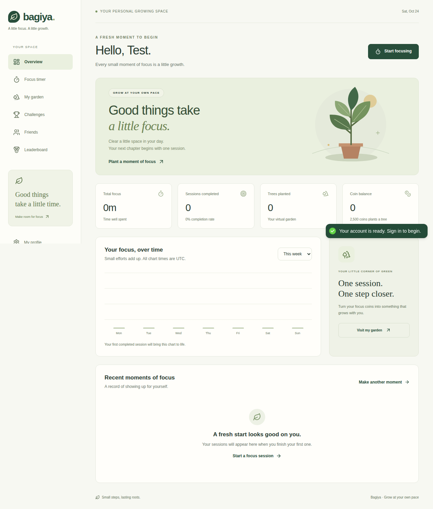

# Bagiya 🌿

A quieter space to focus and grow. Complete focus sessions, earn coins, plant virtual trees, follow your progress, take on milestones and connect with friends.

Bagiya uses React/Vite, Express/Mongoose and MongoDB. It does **not** manage physical plant care or arrange real-world tree planting.



## Run locally

Install Docker with Compose and Make, then:

```sh
cp .env.example .env
make dev-up
make migrate
```

Open **http://localhost:5173** and create an account. No seed credentials are required. On this working machine, `.env` uses **http://localhost:5179** and API port **3012** to avoid other projects; keep those values if using the already-running local stack.

If ports are occupied, set `WEB_PORT`, `PORT` and a matching `CLIENT_ORIGIN` in `.env`. Database data persists across `make dev-down` and restarts. MongoDB is private to the development network. See [development](docs/DEVELOPMENT.md) for hot reload, dependency updates and host-only setup.

## What works

- Register with debounced username availability, live password checks and password visibility controls. Sign in using email, username or phone.
- View your profile, choose Edit, then Save changes or Cancel.
- Start, pause, resume, cancel and recover focus timers after refresh, with animated seed-to-tree growth.
- Earn 100 coins per successfully completed minute; spend 2,500 coins on a virtual tree.
- See real focus charts, an animated nursery calendar with one plant per day (or a trunk on interrupted-only days), session history and wallet history.
- Daily login earns 10 coins once per UTC day. Other proposed milestones stay disabled pending approved rules.
- Search usernames, send/accept/remove friend requests and optionally join the leaderboard with a champion podium and proportional top-three bars.
- Use responsive screens with loading, empty, error and retry states.

## Developer commands

Host checks require Node 22 or 24:

```sh
make install
make lint
make test
make build
make help
```

`make test` runs unit/HTTP boundary tests. Database and browser suites use an isolated replica set; follow [testing](docs/TESTING.md). `make prod-build` builds local production images without deploying. `make clean` does not erase database volumes.

## Project notes

- [Audit and prioritized checklist](docs/PROJECT_AUDIT.md)
- [Flow inventory](docs/FLOW_INVENTORY.md)
- [Architecture and API contracts](docs/ARCHITECTURE.md)
- [Database, migration and recovery guide](docs/DATABASE.md)
- [Development and production preparation](docs/DEVELOPMENT.md)
- [Tests and verification limits](docs/TESTING.md)
- [Security assumptions](docs/SECURITY.md)
- [Implementation report](docs/IMPLEMENTATION_REPORT.md)

The legacy tracked environment file has been sanitized. Any real historical credentials still need owner rotation and Git-history review. Production TLS/database provisioning, uploads, email/password recovery and real-world planting integrations are not configured. No production deployment was performed.

## Strict focus extension

The timer includes optional **Strict focus** with allowed websites and a 90-second monitoring timeout. Desktop users install the unpacked Chrome/Edge extension from the timer’s setup panel, then connect it to the app. Normal focus remains available without an extension. See [installation, behavior and limits](docs/STRICT_FOCUS.md). Run `make extension` to rebuild the download.
